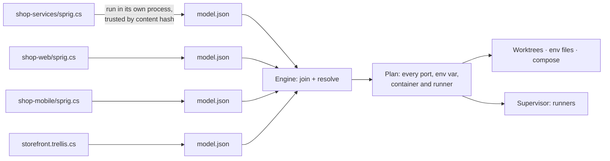

# Experimental roadmap

Branch: `experimental`. Started 2026-11-03. Status: M0 to M6 done (M1 was a go: C# definitions confirmed, findings in [spikes/m1-authoring.md](spikes/m1-authoring.md); M6's Aspire comparison is in [spikes/m6-aspire.md](spikes/m6-aspire.md)). Next: the steps to replace `main`, below M6.

This branch rebuilds Sprig from scratch around two changes:

1. **Code-first definitions.** Repos and systems are described in C#, with full IntelliSense, instead of being assembled from many small GUI forms.
2. **Sprig runs things.** It provisions worktrees, ports, env and infra, and also launches your apps through *runners*, with ordering and dependencies.

Every capability is something you opt into by adding it to your definition. Run a monorepo in place with no worktrees. Add worktrees. Add random ports, or stable ones, or pinned ones. Add groups to start a slice. Stop one app and debug it in your IDE. The definition only grows when you want more behaviour.

The background and the comparison with Aspire are in [artefacts/authoring-redesign.html](artefacts/authoring-redesign.html).

---

## Decisions so far

| Topic | Decision |
|---|---|
| Names | **Trellis and sprout.** A *trellis* is the C# file that joins repos (the roadmap first called it a composition). A *sprout* is one running copy of a trellis (first called an instance). "System" was too generic. |
| Where definitions live | **Repos describe themselves, and a trellis puts them together.** Each repo has a `sprig.cs`. A trellis file (`<name>.trellis.cs`) picks repos, sets policies (worktrees, ports, groups) and fills in what repos ask for. |
| Where trellises live | **Any folder, registered once.** `sprig trellis add <file>` registers a trellis wherever it is: beside the repos, in a team repo, or in sprig's store. |
| Editing | **External IDE first, in-app editor second.** A `Sprig.Sdk` NuGet package plus .NET 10 file-based apps (`#:package`), so VS Code and Rider give IntelliSense with no setup. An in-app editor (AvaloniaEdit + Roslyn) is part of the M1 spike. |
| "Safe" means all of | Running repo code is secure. Roslyn doesn't destabilise the app. EDR (CrowdStrike, Defender) doesn't block it. The GUI can make simple edits to the C# without mangling it. |
| Infra | **Declared in code, with compose still allowed.** Postgres, Redis and the like are declared in C# and Sprig generates the compose file. A repo can still point at its own `docker-compose.yml` and override values. |
| Test system | **Mix of mono and poly.** One monorepo with two .NET APIs, plus separate repos for a Vue web app and an Ionic app. Infra: Postgres, Redis, RabbitMQ, Mailpit. |
| Old code | **New model, copy helpers as needed.** Delete the old model, wiring, maps, pool and editors. Keep the app shell, theme, graph controls, updater and changelog. Copy small proven helpers (git worktree wrapper, `ProcessRunner`, port allocator) into the new engine when a milestone needs them. |
| Run experience | **A log pane per runner in the app**, with start, stop and restart. Telemetry (traces, metrics) comes later, probably through the standalone Aspire dashboard. |
| What a sprout chooses | (User, 2026-11-06.) **Worktrees or in place, the branch to start from, and the port policy belong to each sprout**, chosen when it's made, not to the trellis's code. A repo says what it runs, a trellis which repos run together and how they're wired, and a sprout how this copy runs. Plan: [sprout-choices-plan.md](sprout-choices-plan.md), which also covers sprouting one repo without a trellis. |
| Repo first | (User, 2026-11-06.) **Single repos come first, orchestration second.** Plain names: repo, workspace (was sprout) and orchestration (was trellis). A repo always runs on its own: what it takes from outside is a setting with a default, and a workspace's own value beats the orchestration's, which beats the default. Several definitions per folder stay. Plan: [repo-first-plan.md](repo-first-plan.md). |
| A sprout's definitions | (User, 2026-11-04.) **Read from the sprout's worktrees, approved by content per repo.** A branch that changes `sprig.cs` takes effect in its sprout straight away. Approvals are kept per repo's own `sprig.cs`, several versions each, so a worktree's copy runs if that exact content was approved for the repo before, and a new version asks once, whichever worktree it's in. |

---

## Proposed design: cross-repo orchestration

The open question was how repos refer to each other when each one is its own C# program. The proposal: **repos never compile against each other.** Each definition runs on its own and outputs *data*. The Sprig engine joins that data.



### How the pieces connect

- **A repo exports and imports named values.** `repo.Export("catalog-url", catalog.Url)` makes a value public. `repo.Import("catalog-url")` asks for one. These are the repo's contract, the same idea as today's provides and needs, but typed (`Url`, `ConnectionString`, `HostPort`, `Secret`, `Literal`).
- **The trellis joins them.** An import binds automatically to the single export with the same name across the trellis's repos. The trellis steps in only when that fails: two exports with the same name, an import nobody exports, or a value the trellis supplies itself (shared infra such as Mailpit).
- **Values are references, not strings.** At definition time nobody knows the port. `$"http://localhost:{api.Port}"` uses a custom interpolated string handler, so it builds an expression (`http://localhost:{catalog-api.http.port}`) that the engine fills in at resolve time. You get IntelliSense and type checking without the code needing real values.
- **Errors point at your code.** SDK methods record `[CallerFilePath]` and `[CallerLineNumber]`, so "import `orders-url` has no export" points at `shop-web/sprig.cs:7`.
- **Each repo is evaluated on its own.** A broken definition in one repo fails that repo with a clear error, not the whole compile.

### Sketch: a repo (the monorepo)

```csharp
#:package Sprig.Sdk@0.1.*
using Sprig;

var repo = Repo.Describe("shop-services");

var pg     = repo.Postgres("pg").WithVolume();
var cache  = repo.Redis("cache");
var bus    = repo.RabbitMq("bus");
var smtp   = repo.Import<Url>("mail-smtp");              // filled in by the trellis

var catalog = repo.DotNet("catalog-api", "src/Catalog.Api")
    .Http("http")
    .Env("ConnectionStrings__Db", pg.Database("catalog"))
    .Env("Redis__Url", cache.Url)
    .Env("Bus__Url", bus.Url)
    .WaitFor(pg, bus);

var orders = repo.DotNet("orders-api", "src/Orders.Api")
    .Http("http")
    .Env("ConnectionStrings__Db", pg.Database("orders"))
    .Env("Bus__Url", bus.Url)
    .Env("Smtp__Url", smtp)
    .After(repo.Job("migrate", "dotnet run --project tools/Migrate"))
    .WaitFor(pg, bus);

repo.Export("catalog-url", catalog.Url);
repo.Export("orders-url", orders.Url);

return repo.Emit(args);
```

### Sketch: a consumer repo

```csharp
#:package Sprig.Sdk@0.1.*
using Sprig;

var repo = Repo.Describe("shop-web");

var web = repo.Node("web", ".")
    .Http("http", pin: "5170-5173")                      // pinned set, e.g. auth callbacks
    .EnvFile(".env.local", e => e
        .Set("VITE_CATALOG_URL", repo.Import<Url>("catalog-url"))
        .Set("VITE_ORDERS_URL",  repo.Import<Url>("orders-url")));

web.Run($"npm run dev -- --port {web.Port}");

return repo.Emit(args);
```

### Sketch: the trellis (`storefront.trellis.cs`)

```csharp
#:package Sprig.Sdk@0.1.*
using Sprig;

var trellis = Trellis.Describe("storefront");

var services = trellis.Repo("../shop-services");         // a path or a git URL
var web      = trellis.Repo("../shop-web");
var mobile   = trellis.Repo("../shop-mobile");

var mail = trellis.Mailpit("mail");                      // shared infra owned by the trellis
trellis.Bind("mail-smtp", mail.SmtpUrl);

trellis.Worktrees(from: "main");                         // leave out to run in place
trellis.Ports(PortPolicy.Stable);                        // Random | Stable

trellis.Group("web",    web, services);
trellis.Group("mobile", mobile, services.Only("catalog-api"));

return trellis.Emit(args);
```

### Running repo code safely (to prove in M1)

- **Trust on first use, keyed by content hash.** This works like `direnv allow` or VS Code workspace trust. Sprig only runs a `sprig.cs` whose exact contents you approved. A branch that changes the file asks again and shows the diff.
- **A separate process with a time limit.** Definitions run in their own process, with secrets removed from the environment. This protects the app's stability. It is not a sandbox: .NET can't fully confine code, so trust is the real control.
- **Cached output.** The emitted `model.json` is cached by content hash and SDK version, so normal use never recompiles. Committing a `sprig.lock.json` lets CI or a cautious teammate use a definition without running it.
- **Running code is opt-in.** Sprig never runs a definition just because you checked out a branch. It runs on `plan` or `up`, after trust.

---

## Milestones

Sizes are rough, for one developer working with Claude, based on the pace on `main` (about 27k lines plus 12k of tests in four months).

### M0: Reset the branch ✅ done 2026-11-03

Clear the old model out and leave a clean skeleton that builds.

- Deleted the old engine model, wiring, maps, pool, repo editors, guided tour and coachmarks, their tests, `examples/`, the Claude plugin and the sandbox script. Old plan docs moved to `docs/history/main/`.
- Kept the app shell (`MainWindow`, nav, page layout), the theme brushes, Settings (port range, restricted ports, changelog toggle), About, the Velopack updater and the changelog window. The CLI keeps `open`, `update` and `shell`.
- `Sprig.Core` became `Sprig.Engine`, keeping only the changelog parser, process runner, settings store, app profile and shell PATH install. `Sprig.Sdk` exists as an empty package project.
- The store moved to `sprig-exp` (`sprig-exp (Dev)` for Debug builds), so this build can never read or overwrite the released app's data. A test guards it.
- The app is versioned `0.100.0-exp`. Never tag from this branch: the release workflow publishes on any `v*` tag.
- **Changed from the plan:** the graph controls (`MapWiringCanvas`, `RowGraphControl`, `MapGraphLayout`) and `OperationProgressWindow` were built on the old model's types, so they couldn't be kept compiling. They come back from `main` when M3 (graph view) and M4 (progress window) need them, adapted to the new model.

**Done when:** the app opens with empty pages, `dotnet build` and `dotnet test` pass, and the CLI prints help. Met: 48 tests pass and `sprig --help` lists `open`, `update` and `shell`.

### M1: Spike C# authoring, a go/no-go gate ✅ done 2026-11-03: go

Answer each question with evidence and write the findings to `docs/spikes/m1-authoring.md`.

**Outcome:** every question passed. IntelliSense works in the IDE and in the app's editor. The in-app editor needs style refinement before it's more than a spike; that's tracked under Later.

| Question | How we test it | Pass |
|---|---|---|
| Can a definition emit its model? | `dotnet run sprig.cs -- emit` with `#:package Sprig.Sdk` from a local feed | Valid `model.json`. Cold and warm timings recorded. |
| Is IntelliSense good outside the app? | Open `sprig.cs` in VS Code (C# Dev Kit) and Rider | Completion, docs and errors with no project file |
| Is an in-app editor practical? | AvaloniaEdit with Roslyn completion and diagnostics, running out of process | Completion under 200 ms. App memory and startup measured. A crash in the Roslyn host doesn't take down the app. |
| Is running repo code secure? | Trust store keyed by content hash, approve and re-prompt flow, scrubbed env, time limit | A changed file on a new branch is never run without approval |
| Will EDR allow it? | Compile and run definitions on this machine with CrowdStrike and Defender active | No blocks. If something is flagged, record exactly what, and test whether a committed `sprig.lock.json` avoids it. |
| Can the GUI round-trip edits? | Roslyn syntax rewrites: add an env var, change a port rule, add an import | Comments and formatting kept. Code it doesn't recognise is shown read-only. |

**Fallback if execution fails:** keep the same SDK model but make the primary format a data file (the schema 2 idea), with C# as an optional generator.

### M2: Test system ✅ done 2026-11-03

A script (`scripts/testbed.ps1`, like `scripts/sandbox`) builds real git repos in a throwaway folder. None of them has a `sprig.cs` yet; M3 adds those.

| Repo | Contents |
|---|---|
| `shop-services` (monorepo) | `catalog-api` (.NET minimal API: Postgres and Redis, consumes RabbitMQ), `orders-api` (.NET: Postgres, publishes to RabbitMQ, sends mail through Mailpit), a `migrate` tool |
| `shop-web` | Vue + Vite. Lists the catalog and places an order. |
| `shop-mobile` | Ionic Vue, run in the browser (`ionic serve`), no emulator. Reads the catalog. |

Each app has `/health` and a **config page** showing every value it received and where it came from. That page is the visible proof that the wiring worked in every later milestone.

**Done when:** the script creates the repos, and each app runs by hand on its default ports.

**Outcome:** templates in `testbed/repos`, built by `scripts/testbed.ps1` (see `testbed/README.md`). Verified by hand: infra up, `Migrate` ran, both APIs reported every dependency reachable with the right sources, an order went through `catalog-api` and landed in Mailpit, and both front ends rendered the catalog in headless Edge. Two things for later milestones came out of it:

- Compose host ports are overridable (`PG_PORT` and so on), because a Postgres already ran on 5432 here. Sprig's compose generation (M4) should expect existing infra on default ports.
- Vite refuses to serve a project whose path contains a Windows 8.3 short name (`%TEMP%` is often one). Sprig must expand paths to their long form before starting apps or writing worktrees (M4, M5).

### M3: Primitives for variables, sharing and infra links ✅ done 2026-11-03

- **SDK:** `Repo`, `Trellis`, app kinds (`DotNet`, `Node`, generic `App`), `Port` and `Http`, `Export`/`Import`, `Literal`/`Secret`, `EnvFile` targets, `Container` with presets (`Postgres`, `Redis`, `RabbitMq`, `Mailpit`), `ComposeFile` with overrides, `Group`, policies.
- **Engine:** evaluate definitions (trusted, cached), join, resolve references, validate. Errors cite the file and line.
- **`sprig trellis add <file>`** registers a trellis from any folder. **`sprig plan <trellis>`** prints every app's env vars, ports and containers with their resolved values and where each came from, like `terraform plan`.
- **App:** a read-only view of the resolved model: the graph (reusing the graph controls) and a variables table.
- Add `sprig.cs` files to the test system.

**Done when:** `sprig plan storefront` is correct for all four apps, and resolution has tests for automatic binding, ambiguity, missing imports, pinned ports and compose overrides.

**Outcome:** met. `sprig plan storefront` resolves every value for all four apps with no problems, in 3.8 s first time and 0.55 s from the cache. Planner tests cover each case above plus type mismatches, private names per repo, trellis-owned infra, groups and unused bindings; an integration test plans the real testbed definitions.

- **Changed from the plan:** the app's Trellises page shows a *wiring* list (which app gets which value from which repo) instead of a drawn graph. The old graph controls were built for the old model; bringing a graph back is under Later.
- **Not yet in the SDK:** one-off jobs (`repo.Job`, for `Migrate`) arrive with runners in M5.
- **For M4:** .NET apps read process env vars, which only a runner (M5) can set. For M4's by-hand runs, sprig needs to put .NET values somewhere `dotnet run` reads: a generated `launchSettings.json` profile in the worktree is the likely answer. Compose services a repo doesn't name in its `sprig.cs` keep their file's fixed ports, so they'd clash between sprouts; M4 should warn about them (the testbed's Mailpit moved to a `standalone` profile for this reason).

### M4: Worktree and infra up in one step ✅ done 2026-11-03

- **`sprig up storefront --sprout feat-x --branch feat-x`** creates worktrees (or runs in place), allocates ports by policy, writes env files, generates compose under its own project name, runs `docker compose up -d` and waits for health. All in one step, with progress in the app.
- Port policies: random (fresh each `up`), stable (leased per sprout), pinned (an allowed set on a port).
- `sprig down` stops infra. `sprig rm` removes the sprout, with an option to delete the branch.
- **App:** a "New sprout" flow, a sprouts list and the progress window.

**Done when:** two sprouts of `storefront` run side by side, each with its own Postgres volume and ports, and each from one command. The monorepo alone also runs in place with no worktree.

**Outcome:** met. Two sprouts of `storefront` came up side by side, each from one `sprig up`, with their own worktrees, ports and `pgdata` volume. `catalog-api` and `orders-api` ran in both with plain `dotnet run` from the worktrees, and each API's `/config` page reported its own sprout's Postgres, Redis, RabbitMQ and Mailpit as reachable. Ports held across `down` and `up`. `services.trellis.cs` ran the monorepo in place. `sprig rm` left no containers, volumes, worktrees, branches or files behind.

Decisions made at the start of M4 (by the user):

- **Values go to `.env` files first.** Other formats are opt-in outputs on an app: `.Output(EnvOutput.LaunchSettings())` (a profile placed first in `Properties/launchSettings.json`, used by `dotnet run` and IDEs), `.Output(EnvOutput.AppSettings(file))` and `.Output(EnvOutput.DotEnv(file))`.
- **The repo opts in to every file sprig writes.** A target must be a file the app (or its tooling) reads, and the repo's own ignore rules must cover it. Sprig refuses a tracked file, and refuses one git doesn't ignore, saying what to add to `.gitignore` (and, for an appsettings file, the `AddJsonFile` line the app needs). `sprig plan` reports this too, and `up` checks before it creates anything. Sprig adds no ignore rules of its own. An early version wrote to `.git/info/exclude`, but every worktree shares that file, so the rules leaked into the main checkout, stayed hidden from the team and were never cleaned up. It also hid whether the app read the file at all. The testbed shows both routes: `catalog-api` uses a launch profile and `orders-api` loads `appsettings.Local.json`, and both files are in the repo's `.gitignore`.
- **Replaced on 2026-11-09 (by the user): values only ever go into files.** Sprig never sets a value on an app's process, so `dotnet run`, `pnpm dev`, an IDE or another tool started in a worktree gets exactly what sprig's own run does, and sprig can be used for worktree isolation alone. `.Env(...)`, `Http(portEnv:, urlEnv:)` and `.Output(...)` are gone. An app or job names the file for each value with `.EnvFile(file, …)`, `.AppSettings(file, …)` or `.LaunchSettings(…)`. A Run command can't carry a value either. `dotnet` apps run as a plain `dotnet run`, launch profile and all, and `sprig env` and the app's **Copy env** were removed.
- **Compose services a repo's `sprig.cs` doesn't name are left out of sprouts**, with a warning from `sprig plan`. Services behind a compose profile don't count, since they don't start by default.

Also in M4:

- **One compose project per infra source:** `sprig-<trellis>-<sprout>` for containers declared in code, and `sprig-<trellis>-<sprout>-<repo>` for each repo's compose file. The sprout's copy of a repo's compose file lives in the store and runs with the repo (or worktree) as its project directory. It keeps only the named services, maps their ports to `127.0.0.1`, drops `container_name` and `profiles`, and prunes `depends_on`.
- **Health:** presets have health checks, and `compose.Service(...).Health(cmd)` adds one to a repo's service. `up` waits with `docker compose up --wait`; without a check, it only waits for the service to be running.
- **Worktrees** go in `<folder holding the repos>/<trellis>--<sprout>/<repo>`, keeping the repos' layout (a `SproutsFolder` setting moves them). A new branch starts from the trellis's `Worktrees(from:)`, an existing local or remote branch is checked out, and a fresh worktree's dotenv files start from the main checkout's copy.
- **`sprig sprouts`** lists sprouts, and **`sprig env <trellis> <sprout> <app>`** prints an app's env vars for an IDE or shell.
- **Model schema 2** (app outputs, health checks). The definition cache key includes the schema, and a definition built with an older SDK is refused with a message.
- **Found by running it:** `appsettings.json` with `urls` beats `ASPNETCORE_URLS`, so .NET apps should take their url in `Urls` (the testbed now does). Two `dotnet run`s in one worktree race to build a shared project; M5's runners should build once and then run with `--no-build`.
- **Not done:** a sprout's definitions are evaluated from the repos' main checkouts, not its worktrees, so a branch that changes `sprig.cs` isn't reflected until it's merged. Trust is per path, so evaluating worktrees means deciding how approval carries across to them.

### M5: Runners ✅ done 2026-11-03

- **Runner per app:** command, working folder, resolved env, readiness check (port open, HTTP health, or a line in the log), restart policy.
- **Order and dependencies:** `WaitFor(x)` waits until x is ready. `After(job)` waits for a one-off job such as migrations to finish. Starting a group starts its members and everything they depend on.
- **Supervisor:** Windows Job Objects so stopping a runner kills its whole process tree, a graceful stop before a forced one, and state tracking (starting, ready, failed, stopped).
- **Debug in your IDE:** stop one runner and its port stays leased. Env files already hold its values, and `sprig env <app>` prints them for an IDE launch profile. Start it from Rider or VS Code on the same port and the rest of the system keeps working.
- **Output:** a log pane per runner in the app (ANSI colour, follow, search, virtualised for large logs). `sprig up --run` in the CLI shows prefixed, interleaved output like `docker compose up`.

**Done when:** one command brings up infra, runs `migrate`, starts both APIs once Postgres and RabbitMQ are ready, then starts web and mobile. You can stop `catalog-api` in the app, run it from your IDE, and the web app still works.

**Decision (by the user, 2026-11-03): runners live in a background host, not in the app or CLI.** `sprig-host` is started on demand by either. There's one per store, reached over a named pipe only the current user can open, so the CLI and the app see and control the same runners, and apps keep running when the window closes or the CLI exits. It exits after 10 idle minutes. Each runner is in its own Job Object, so stopping it ends its whole tree, and because those jobs close with the host, a host that dies takes its apps with it rather than leaving orphans.

**Spike (done 2026-11-03):** `sprig start|stop|ps|logs <trellis> <sprout> [apps]` and `sprig host status|stop`. `down` and `rm` stop a sprout's apps first.
- Started from the CLI, both testbed APIs were built (one build per repo at a time), started with `dotnet run --no-build --no-launch-profile`, and reported ready on their ports in 9 s. They kept running after the CLI and its shell exited, and their `/config` pages showed their sprout's values.
- `sprig stop` on one app ended its `dotnet` process and the app under it, and freed its port. Killing `sprig-host` outright ended everything it ran. `rm` with an app running stopped it, then removed the worktrees cleanly.
- Nothing was blocked on this machine. Whether CrowdStrike or Defender raised alerts that don't block is a question for SecOps' consoles.
- **Found:** a host started the ordinary way inherited the CLI's stdout, so `sprig start | tail` hung until the host exited. It's now shell-executed, so it inherits no handles.
- **Found:** with no launch profile, ASP.NET runs as Production, so runners set `ASPNETCORE_ENVIRONMENT`/`DOTNET_ENVIRONMENT` to Development unless the app sets them.

**Ordering and jobs (done 2026-11-03):**
- `repo.DotNetJob(...)` and `repo.Job(...)` declare one-off commands. There's no separate `After`: `WaitFor` means "ready" for an app, "finished with code 0" for a job, and "healthy" for infra (already true after `up`).
- The planner gives each app a `DependsOn`: what it waits for (a loop there is an error), plus apps whose urls or ports reach it through its values, added only when that doesn't close a loop. So `web` starts after the APIs it imports without saying so, and two services that call each other start in declaration order.
- The host does the ordering: builds run up front (one per repo at a time), then each runner waits for its dependencies. A failed job or app fails what waits for it, with the reason. `sprig start <trellis> <sprout> [apps] [--group g]` brings what they depend on. Apps named outright restart, and everything else already going is left alone.
- Node apps in a fresh worktree get `npm ci --ignore-scripts` (or `npm install --ignore-scripts` without a lockfile) as their build step.
- **Run against the testbed:** `sprig start storefront feat-a` installed and built everything and ran `migrate`, then started `catalog-api`, then `orders-api`, then `web` (after both APIs) and `mobile`, all ready in 23 s. Stopping `catalog-api` and running it by hand with `dotnet run` from the worktree put it back on its leased port with the sprout's values. `orders-api` placed an order through it, and the email reached Mailpit.

**Graceful stop (done 2026-11-03):**
- Stopping sends Ctrl+C to the app's own hidden console (the host attaches to it briefly) and ends the job only if a real program (not `cmd`, `conhost` or `sh`) is still running after 10 s. The log says how it went ("stopped in 0.2s", or what was still running when it was ended), and so do `sprig stop` and `sprig ps`.
- `stop`, `down`, `rm` and a restart wait until the app has gone. A restart rebuilds only then, because a running app locks the files its build writes. The host stops everything this way when it shuts down.
- On the testbed: the APIs log "Application is shutting down..." and exit 0 in 0.2 s, and the Vite apps stop in about 1.3 s. `down` with all four running stopped them, then the infra, in 5 s.
- **Found the hard way, all handled now:**
  - Windows passes an "ignore Ctrl+C" flag from parent to child, so the host clears it at startup, or apps it starts could inherit it and never stop gently.
  - The host is attached to the app's console while it signals, so it gets the Ctrl+C too. A handler protects it (the null "ignore" flag would be inherited by its apps). The handler must be added on every attach, since one from an earlier console doesn't protect it in the next, and never removed, since Ctrl+C can arrive late.
  - npm and vite are `.cmd` batch files, so `cmd` answers Ctrl+C with "Terminate batch job (Y/N)?"; the host writes "Y" to the app's stdin after a second.
  - Stopping is marked before the request returns, or a quick status check could read a stale "ready" as done.

**Readiness and restarts (done 2026-11-03):**
- **Readiness:** `.Http(health: "/health")` makes an app ready once that path answers with a success status, and `.ReadyOnLog(pattern)` once a line of its output matches a regular expression (colour codes removed first). With both, both must pass; with neither, the open port still decides. The planner rejects a path that doesn't start with `/` and a pattern that doesn't compile. The health check skips any proxy and tries `127.0.0.1` and `::1` with short timeouts each, because on Windows a refused connection takes about 2 s, which would use up a whole request on the wrong address. Only status codes are logged while it waits (connection errors are normal during startup), and only when they change.
- **Restarts:** `.Restart(RestartPolicy.OnFailure | Always, max: 5)` on an app and `.Retry(max: 3)` on a job. Waits 1 s, 2 s, 4 s and so on up to 30 s between tries, and a run that lasted a minute starts the count again. While it waits, the runner is `Restarting` (alive, not settled), so what depends on it keeps waiting instead of failing. A stop you ask for, including one during the wait, never restarts it. Anything the last run left in its job is ended first, so a stray child can't hold the port. `sprig ps` shows "(restarted 2×)".
- Model schema 4 (`EndpointModel.Health`, `AppModel.ReadyLog` and `Restart`).
- **On the testbed:** both APIs became ready through `/health`, mobile through Vite's `ready in 312 ms` line, and web through its port. Killing `catalog-api`'s app process brought it back in 1 s, ready through `/health` again, and `sprig stop` afterwards left everything stopped.
- **Found:** a process can exit between `Process.GetProcessById` and reading its name (when the host was shutting down, this crashed it), which throws `InvalidOperationException`, not `ArgumentException`. Only the latter was caught, and the exception escaped the fire-and-forget stop task, leaving the runner `Stopping` for good. Both are caught now, and a stop that throws anyway still ends the job and reports why.
- **Found:** `HostClient.TrySend` threw "Pipe is broken" when it reached a host that was shutting down, because disposing its `StreamWriter` flushed into the closed pipe. It writes to the pipe directly now and treats a dropped connection as no host.

**Following and detached runs (done 2026-11-03):**
- **Decision (by the user):** `sprig up --run` follows the apps from the CLI, so Ctrl+C there stops them. `-d/--detached` starts them, waits until they're ready and returns, leaving them in the host. The infra stays up either way, since it holds data and is slow to bring back; `sprig down` stops it.
- `--run` prints every app's log as one stream, `name |` prefixes in a colour per app and aligned, with sprig's own lines dimmed and the apps' colours passed through (removed when output is redirected). A second Ctrl+C leaves at once and the host finishes the stops. If the apps end on their own, or something else stops them, it says so and exits.
- On the testbed: `up -d` brought everything up ready, and `up --run` on the same sprout left the running apps alone and followed them. A `sprig stop` from another terminal showed each graceful stop in the stream, then "The apps were stopped."
- **Found:** the second `up` rewrote each `.env.local` with the same values, and Vite restarted both front ends. Env files are now written only when their content changes.
- **Found, and the cause of the long-running "flaky host tests":** sending Ctrl+C sometimes killed `sprig-host` itself, and every app with it. To signal, the host attached to the app's console and relied on a handler to absorb its own copy of the Ctrl+C. Now and then the host simply exited, leaving no crash record. Two tests that stop apps in quick succession hit it every few runs. Now a short-lived `sprig-host --ctrl-c <pid>` helper attaches and signals instead, so the host never joins an app's console. The same tests then passed 20 runs in a row. Before the change, about one full-suite run in three failed, on the earlier commits too.

**The app's runners and log pane (done 2026-11-03):**
- The Sprouts page's app rows show each runner's state from the host, polled every second while the page shows: building, waiting, starting, ready, restarting (with why and when), finished for a job, exited or failed (with the reason). Each has Start (Restart when it's going), Stop and Log, and the panel has Start all and Stop apps. Starting needs the sprout up, and says so otherwise. The sprout's own "Stop" button became "Take down", since it stops the infra too.
- The log pane follows one app's log: its colours (SGR codes as styled runs, retuned for the dark theme), sprig's lines dimmed, a search that shows only matching lines ("12 of 3,400 lines match"), Follow, and a virtualised list that keeps the newest 20,000 lines. A runner started afresh replaces what was shown. Following scrolls only the log, not the page.
- `LogTail` and `AnsiText` (Engine/Hosting) serve both this pane and `up --run`.
- Checked with view-model tests and headless renders against a live sprout, in `captures/`; hand testing waits for the user's pass over the UI.

**Outcome:** met. One command (`sprig up storefront --sprout x -d`, or `--run` to follow) brings up the infra, runs `migrate`, starts both APIs once Postgres and RabbitMQ are healthy, then web and mobile. `catalog-api` can be stopped (from the app or `sprig stop`) and run from an IDE on its leased port with the sprout's values, and the rest keeps working (shown with `dotnet run` from the worktree earlier in M5).

### M6: Review and decide (about 2 weeks)

**Before M6 (done 2026-11-04): a sprout runs its branch's definitions.**
- `up` reads each repo's `sprig.cs` from the sprout's worktree: for an existing sprout before the dry plan, and for a new one right after its worktrees are made (a "Definitions" step). Compose files are read from the same place. `sprig plan <trellis> --sprout <name>` does the same for an existing sprout.
- The trust store keeps up to 20 approved versions per file. A worktree's copy is checked against its repo's own `sprig.cs` (`DefinitionRunner.Evaluate(file, trustAs)`, `NeedsTrust.TrustPath`), so a new branch made from `main` asks nothing, and switching back to `main` doesn't ask again.
- When a branch brings a version that isn't approved, `up` stops after making the worktrees and before writing anything. The CLI asks (or `--trust` approves) and goes again; the app shows the approval panel and carries on once approved. `sprig trust add <worktree>/sprig.cs` approves it for its repo. `sprig trust ls` lists each file once, with how many versions are approved.
- **On the testbed:** a `feat-defs` branch of `shop-web` added `VITE_BRANCH_FLAG=on` to its `sprig.cs`. `sprig up storefront --sprout feat-defs` made the three worktrees and stopped at "Definitions", asking only for shop-web's branch version (the two branches made fresh from `main` asked nothing). After `sprig trust add <worktree>/shop-web/sprig.cs`, `up` came up with the flag in the worktree's `.env.local`, `plan --sprout feat-defs` showed it, plain `plan` (the main checkouts) didn't and asked nothing, and `rm` cleaned up.

- Run the same test system under Aspire (an AppHost with `--isolated`) and compare setup effort, start time, isolation and the debugging workflow. **Done 2026-11-04**, findings in [spikes/m6-aspire.md](spikes/m6-aspire.md): Aspire isolates by the AppHost file's path (a second run of the same AppHost replaced the first and shared its volume), picks new ports every run, and can't hand one app to an IDE (its proxy holds the port and forwards nothing). It started faster (26 s warm against sprig's 50 s), from two causes now fixed: `up -d`/`--run` has the host build while the infra starts (a held `start`), and the file checks are two git calls per repo, run once. Sprig is now **14 s warm and 19 s for a new sprout**.
- Decide whether `experimental` replaces `main`, and how existing `.sprig.json` users move over. **Decided (user, 2026-11-04):** `experimental` replaces `main` once start time is fixed (done) and the user has made their hand pass over the app's UI. **No migration:** the `.sprig.json` format goes, with a changelog note only.
- Firm up the "Later" list below into the next roadmap. **Proposed below**, for the user to reorder.

**Outcome:** met. Sprig keeps what Aspire can't do across repos (worktrees made for you, stable ports, per-sprout data, an IDE taking one app over) and now starts faster than Aspire on the testbed.

---

## Next: replacing `main` (proposed)

1. **The user's hand pass over the app.** Trellises and Sprouts pages, runner rows, log pane, and the new approval prompt during bring-up. Fix what it finds.
2. **The app gets the same head start as the CLI.** **Done 2026-11-11:** Start on a workspace that's down, and Empty data's bring-back, have the host build the apps while the infra comes up (`HostClient.Prebuild`, shared with the CLI's `up` and `empty-data`).
3. **EDR sign-off.** Ask SecOps whether CrowdStrike or Defender raised non-blocking alerts for `sprig-host` (process trees, and its `--ctrl-c` helper attaching to app consoles). Nothing was blocked on this machine. **Done (user, 2026-11-11).**
4. **Merge mechanics.** The store moves from `sprig-exp` to `sprig` (the test guarding the released store changes with it), the version leaves `0.100.0-exp`, `Sprig.Host` gets a version, the changelog says `.sprig.json` is gone, and `Sprig.Sdk` is published as a package so definitions stop needing the local `#:project` line. **Done 2026-11-11** (user): the store is `sprig` / `sprig (Dev)` with no migration; the app is versioned from the last tag (`0.8.2`); the SDK publishes as `ArcticGizmo.Sprig.Sdk` from the release workflow (renamed `publish.yml` to match the nuget.org policy) through NuGet Trusted Publishing, at the tag's version; the home page shows what's running, and Orchestrations are greyed out in the nav until their redesign.

## M7: Authoring in the app, with trellises and repos kept in sprig (in progress)

**Decision (user, 2026-11-04):** sprig should be usable on repos without committing anything. Trellises and repo definitions can both be *virtual*: kept in sprig's store and edited in the app. Several of each can exist, and none may clash with each other or with a definition committed in a repo. The user will judge the details once editing works in the app, so the shape below is a starting point.

1. **Every trellis has an ID.** Set when it's registered or created, unique, and never taken from the code. Sprout records, compose projects, port leases, worktree folders, logs and runners are keyed by it. `Trellis.Describe("storefront")` becomes a display name, so two trellises that both call themselves `storefront` have separate sprouts. Existing registrations keep their name as their ID.
2. **Virtual trellises and repo definitions live in the store,** each under its own ID: `<store>/trellises/<id>/trellis.cs` and `<store>/repos/<id>/sprig.cs`. There can be any number of each, including several definitions for the same repo folder. Approval stays per file; saving in the app approves what was saved.
3. **A trellis names the definition it uses for each repo.** `trellis.Repo("C:/src/shop-web")` uses the repo's committed `sprig.cs`; `trellis.Repo("C:/src/shop-web", definition: "shop-web-local")` uses a virtual one. Nothing is picked up because it happens to be there, so a committed file and any number of virtual ones never compete. A virtual definition is the same for every sprout, since no branch can change it.
   - **Repos list (user, 2026-11-05).** A repo is a first-class entry: an ID, a folder, and its definition, either written in sprig or the folder's own `sprig.cs` (referenced, so it can be opened in the app). `trellis.UseRepo("id")` brings in both, keeping paths out of trellis code; the path forms stay, since the user wants more than one way to reference a repo. Entries live at `<store>/repos/<id>/` (`repo.json`, plus `sprig.cs` when written in sprig).
   - **Redesign (user, 2026-11-05).** The Trellises page was too much to take in, so it was redesigned from the options in [artefacts/trellis-options/](artefacts/trellis-options/); the checklist is [trellis-page-plan.md](trellis-page-plan.md). "Virtual" is gone: every repo and trellis is **in repo** or **in sprig**. `Repo(path, definition:)` was removed, leaving `Repo(path)` (the folder's own `sprig.cs`) and `UseRepo(id)` (a Repos entry, whose definition is the folder's file or one kept in sprig, fixed for that ID). Repos have their own page; a trellis opens on a summary with a picture of its repos and the values between them, Start a sprout, and a checklist while something blocks it. Model schema 7.
   - **One kind per ID (user, 2026-11-05).** A switch that changed an ID between the folder's file and sprig's copy made no sense: what a trellis using the ID ran could change under it. An ID is now in repo or in sprig for good. **Copy into sprig** makes a new in-sprig ID from a repo's `sprig.cs`; **Write to the repo** writes an in-sprig definition into the folder as `sprig.cs`, left uncommitted, and uses it from a new in-repo ID. Neither changes the ID it started from or the trellises using it, and sprig never writes over a folder's `sprig.cs`.
   - **From the CLI (2026-11-06).** `sprig repo add|copy|ls|rm` does what the Repos page does, so the testbed's `catalog.trellis.cs` (repos by ID, one in repo and one in sprig) can be set up from a terminal.
4. **Editing in the app.** The M1 editor, polished, for trellises and repo definitions; a new definition starts from what the repo has (a `.csproj` becomes `DotNet(...)`, a `package.json` becomes `Node(...)`), and the plan updates beside the code. The editor is shared by the Repos and Trellises pages; on a trellis it's the Code tab, so the other tabs show what a save changed.

A branch can be checked out in only one worktree, so two trellises making sprouts of the same repo on the same branch still clash; the plan should say which trellis has it.

## Later (after `main`)

- **In-app editor polish:** the M1 editor works but needs style refinement (completion popup, highlighting, problems list) before it becomes a real feature. Also stop the language host after a few idle minutes.
- **Smarter worktree branching and refresh:** pooled warm sprouts, refresh from base, rebasing a sprout.
- **Telemetry:** the standalone Aspire dashboard per sprout, receiving OpenTelemetry (OTLP) data.
- **Live graph:** the trellis picture came with M7's redesign; next, a sprout's own picture with each app's state and a click through to its logs.
- **More languages:** a TypeScript SDK that emits the same `model.json`.
- **Shared trellises:** cloning a team's trellis repo and registering it in one step.

## Risks

- **EDR.** A tool that compiles code, then starts, kills and injects env into many processes is what CrowdStrike and Defender react to. M1 tests this on a real corporate machine before anything is built on top of it.
- **Windows process control.** Clean shutdown, killing process trees, and `dotnet watch` and Vite spawning grandchildren are where tools like this get flaky. This is the bulk of M5's estimate.
- **Evaluation speed.** `dotnet run` on a file-based app has a cold-start cost. Caching by content hash should hide it, but M1 measures it.
- **Positioning.** Running apps puts Sprig in direct competition with Aspire. Its integrations catalogue (one-line Postgres with defaults) is the strongest thing to match. The presets in M3 are the start of that.

## Open questions

- Whether `Sprig.Sdk` targets only .NET 10, or also older SDKs for teams that haven't moved.
