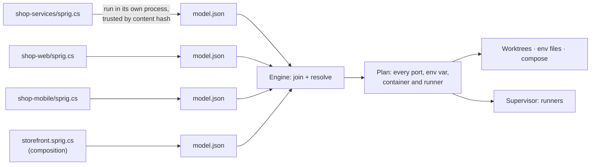

# Experimental roadmap

Branch: `experimental`. Started 2026-11-03. Status: M0, M1 and M2 done (M1 was a go: C# definitions confirmed, findings in [spikes/m1-authoring.md](spikes/m1-authoring.md)). M3 next.

This branch rebuilds Sprig from scratch around two changes:

1. **Code-first definitions.** Repos and systems are described in C#, with full IntelliSense, instead of being assembled from many small GUI forms.
2. **Sprig runs things.** It provisions worktrees, ports, env and infra, and also launches your apps through *runners*, with ordering and dependencies.

Every capability is something you opt into by adding it to your definition. Run a monorepo in place with no worktrees. Add worktrees. Add random ports, or stable ones, or pinned ones. Add groups to start a slice. Stop one app and debug it in your IDE. The definition only grows when you want more behaviour.

The background and the comparison with Aspire are in [artefacts/authoring-redesign.html](artefacts/authoring-redesign.html).

---

## Decisions so far

| Topic | Decision |
|---|---|
| Where definitions live | **Repos describe themselves, and a central composition puts them together.** Each repo has a `sprig.cs`. A composition file picks repos, sets policies (worktrees, ports, groups) and fills in what repos ask for. |
| Editing | **External IDE first, in-app editor second.** A `Sprig.Sdk` NuGet package plus .NET 10 file-based apps (`#:package`), so VS Code and Rider give IntelliSense with no setup. An in-app editor (AvaloniaEdit + Roslyn) is part of the M1 spike. |
| "Safe" means all of | Running repo code is secure. Roslyn doesn't destabilise the app. EDR (CrowdStrike, Defender) doesn't block it. The GUI can make simple edits to the C# without mangling it. |
| Infra | **Declared in code, with compose still allowed.** Postgres, Redis and the like are declared in C# and Sprig generates the compose file. A repo can still point at its own `docker-compose.yml` and override values. |
| Test system | **Mix of mono and poly.** One monorepo with two .NET APIs, plus separate repos for a Vue web app and an Ionic app. Infra: Postgres, Redis, RabbitMQ, Mailpit. |
| Old code | **New model, copy helpers as needed.** Delete the old model, wiring, maps, pool and editors. Keep the app shell, theme, graph controls, updater and changelog. Copy small proven helpers (git worktree wrapper, `ProcessRunner`, port allocator) into the new engine when a milestone needs them. |
| Run experience | **A log pane per runner in the app**, with start, stop and restart. Telemetry (traces, metrics) comes later, probably through the standalone Aspire dashboard. |

---

## Proposed design: cross-repo orchestration

The open question was how repos refer to each other when each one is its own C# program. The proposal: **repos never compile against each other.** Each definition runs on its own and outputs *data*. The Sprig engine joins that data.



### How the pieces connect

- **A repo exports and imports named values.** `repo.Export("catalog-url", catalog.Url)` makes a value public. `repo.Import("catalog-url")` asks for one. These are the repo's contract, the same idea as today's provides and needs, but typed (`Url`, `ConnectionString`, `HostPort`, `Secret`, `Literal`).
- **The composition joins them.** An import binds automatically to the single export with the same name across the composition's repos. The composition steps in only when that fails: two exports with the same name, an import nobody exports, or a value the composition supplies itself (shared infra such as Mailpit).
- **Values are references, not strings.** At definition time nobody knows the port. `$"http://localhost:{api.Port}"` uses a custom interpolated string handler, so it builds an expression (`http://localhost:{catalog-api.http.port}`) that the engine fills in at resolve time. You get IntelliSense and type checking without the code needing real values.
- **Errors point at your code.** SDK methods record `[CallerFilePath]` and `[CallerLineNumber]`, so "import `orders-url` has no export" points at `shop-web/sprig.cs:7`.
- **Each repo is evaluated on its own.** A broken definition in one repo fails that repo with a clear error, not the whole compile.

### Sketch: a repo (the monorepo)

```csharp
#:package Sprig.Sdk@0.1.*
using Sprig;

var repo = Repo.Describe("shop-services");

var pg     = repo.Postgres("pg").WithVolume();
var cache  = repo.Redis("cache");
var bus    = repo.RabbitMq("bus");
var smtp   = repo.Import<Url>("mail-smtp");              // filled in by the composition

var catalog = repo.DotNet("catalog-api", "src/Catalog.Api")
    .Http("http")
    .Env("ConnectionStrings__Db", pg.Database("catalog"))
    .Env("Redis__Url", cache.Url)
    .Env("Bus__Url", bus.Url)
    .WaitFor(pg, bus);

var orders = repo.DotNet("orders-api", "src/Orders.Api")
    .Http("http")
    .Env("ConnectionStrings__Db", pg.Database("orders"))
    .Env("Bus__Url", bus.Url)
    .Env("Smtp__Url", smtp)
    .After(repo.Job("migrate", "dotnet run --project tools/Migrate"))
    .WaitFor(pg, bus);

repo.Export("catalog-url", catalog.Url);
repo.Export("orders-url", orders.Url);

return repo.Emit(args);
```

### Sketch: a consumer repo

```csharp
#:package Sprig.Sdk@0.1.*
using Sprig;

var repo = Repo.Describe("shop-web");

var web = repo.Node("web", ".")
    .Http("http", pin: "5170-5173")                      // pinned set, e.g. auth callbacks
    .EnvFile(".env.local", e => e
        .Set("VITE_CATALOG_URL", repo.Import<Url>("catalog-url"))
        .Set("VITE_ORDERS_URL",  repo.Import<Url>("orders-url")));

web.Run($"npm run dev -- --port {web.Port}");

return repo.Emit(args);
```

### Sketch: the composition

```csharp
#:package Sprig.Sdk@0.1.*
using Sprig;

var system = Composition.Describe("storefront");

var services = system.Repo("../shop-services");          // a path or a git URL
var web      = system.Repo("../shop-web");
var mobile   = system.Repo("../shop-mobile");

var mail = system.Mailpit("mail");                       // shared infra owned by the system
system.Bind("mail-smtp", mail.SmtpUrl);

system.Worktrees(from: "main");                          // leave out to run in place
system.Ports(PortPolicy.Stable);                         // Random | Stable

system.Group("web",    web, services);
system.Group("mobile", mobile, services.Only("catalog-api"));

return system.Emit(args);
```

### Running repo code safely (to prove in M1)

- **Trust on first use, keyed by content hash.** This works like `direnv allow` or VS Code workspace trust. Sprig only runs a `sprig.cs` whose exact contents you approved. A branch that changes the file asks again and shows the diff.
- **A separate process with a time limit.** Definitions run in their own process, with secrets removed from the environment. This protects the app's stability. It is not a sandbox: .NET can't fully confine code, so trust is the real control.
- **Cached output.** The emitted `model.json` is cached by content hash and SDK version, so normal use never recompiles. Committing a `sprig.lock.json` lets CI or a cautious teammate use a definition without running it.
- **Running code is opt-in.** Sprig never runs a definition just because you checked out a branch. It runs on `plan` or `up`, after trust.

---

## Milestones

Sizes are rough, for one developer working with Claude, based on the pace on `main` (about 27k lines plus 12k of tests in four months).

### M0: Reset the branch ✅ done 2026-11-03

Clear the old model out and leave a clean skeleton that builds.

- Deleted the old engine model, wiring, maps, pool, repo editors, guided tour and coachmarks, their tests, `examples/`, the Claude plugin and the sandbox script. Old plan docs moved to `docs/history/main/`.
- Kept the app shell (`MainWindow`, nav, page layout), the theme brushes, Settings (port range, restricted ports, changelog toggle), About, the Velopack updater and the changelog window. The CLI keeps `open`, `update` and `shell`.
- `Sprig.Core` became `Sprig.Engine`, keeping only the changelog parser, process runner, settings store, app profile and shell PATH install. `Sprig.Sdk` exists as an empty package project.
- The store moved to `sprig-exp` (`sprig-exp (Dev)` for Debug builds), so this build can never read or overwrite the released app's data. A test guards it.
- The app is versioned `0.100.0-exp`. Never tag from this branch: the release workflow publishes on any `v*` tag.
- **Changed from the plan:** the graph controls (`MapWiringCanvas`, `RowGraphControl`, `MapGraphLayout`) and `OperationProgressWindow` were built on the old model's types, so they couldn't be kept compiling. They come back from `main` when M3 (graph view) and M4 (progress window) need them, adapted to the new model.

**Done when:** the app opens with empty pages, `dotnet build` and `dotnet test` pass, and the CLI prints help. Met: 48 tests pass and `sprig --help` lists `open`, `update` and `shell`.

### M1: Spike C# authoring, a go/no-go gate ✅ done 2026-11-03: go

Answer each question with evidence and write the findings to `docs/spikes/m1-authoring.md`.

**Outcome:** every question passed. IntelliSense works in the IDE and in the app's editor. The in-app editor needs style refinement before it's more than a spike; that's tracked under Later.

| Question | How we test it | Pass |
|---|---|---|
| Can a definition emit its model? | `dotnet run sprig.cs -- emit` with `#:package Sprig.Sdk` from a local feed | Valid `model.json`. Cold and warm timings recorded. |
| Is IntelliSense good outside the app? | Open `sprig.cs` in VS Code (C# Dev Kit) and Rider | Completion, docs and errors with no project file |
| Is an in-app editor practical? | AvaloniaEdit with Roslyn completion and diagnostics, running out of process | Completion under 200 ms. App memory and startup measured. A crash in the Roslyn host doesn't take down the app. |
| Is running repo code secure? | Trust store keyed by content hash, approve and re-prompt flow, scrubbed env, time limit | A changed file on a new branch is never run without approval |
| Will EDR allow it? | Compile and run definitions on this machine with CrowdStrike and Defender active | No blocks. If something is flagged, record exactly what, and test whether a committed `sprig.lock.json` avoids it. |
| Can the GUI round-trip edits? | Roslyn syntax rewrites: add an env var, change a port rule, add an import | Comments and formatting kept. Code it doesn't recognise is shown read-only. |

**Fallback if execution fails:** keep the same SDK model but make the primary format a data file (the schema 2 idea), with C# as an optional generator.

### M2: Test system ✅ done 2026-11-03

A script (`scripts/testbed.ps1`, like `scripts/sandbox`) builds real git repos in a throwaway folder. None of them has a `sprig.cs` yet; M3 adds those.

| Repo | Contents |
|---|---|
| `shop-services` (monorepo) | `catalog-api` (.NET minimal API: Postgres and Redis, consumes RabbitMQ), `orders-api` (.NET: Postgres, publishes to RabbitMQ, sends mail through Mailpit), a `migrate` tool |
| `shop-web` | Vue + Vite. Lists the catalog and places an order. |
| `shop-mobile` | Ionic Vue, run in the browser (`ionic serve`), no emulator. Reads the catalog. |

Each app has `/health` and a **config page** showing every value it received and where it came from. That page is the visible proof that the wiring worked in every later milestone.

**Done when:** the script creates the repos, and each app runs by hand on its default ports.

**Outcome:** templates in `testbed/repos`, built by `scripts/testbed.ps1` (see `testbed/README.md`). Verified by hand: infra up, `Migrate` ran, both APIs reported every dependency reachable with the right sources, an order went through `catalog-api` and landed in Mailpit, and both front ends rendered the catalog in headless Edge. Two things for later milestones came out of it:

- Compose host ports are overridable (`PG_PORT` and so on), because a Postgres already ran on 5432 here. Sprig's compose generation (M4) should expect existing infra on default ports.
- Vite refuses to serve a project whose path contains a Windows 8.3 short name (`%TEMP%` is often one). Sprig must expand paths to their long form before starting apps or writing worktrees (M4, M5).

### M3: Primitives for variables, sharing and infra links (about 3–4 weeks)

- **SDK:** `Repo`, `Composition`, app kinds (`DotNet`, `Node`, generic `App`), `Port` and `Http`, `Export`/`Import`, `Literal`/`Secret`, `EnvFile` targets, `Container` with presets (`Postgres`, `Redis`, `RabbitMq`, `Mailpit`), `ComposeFile` with overrides, `Group`, policies.
- **Engine:** evaluate definitions (trusted, cached), join, resolve references, validate. Errors cite the file and line.
- **`sprig plan <composition>`** prints every app's env vars, ports and containers with their resolved values and where each came from, like `terraform plan`.
- **App:** a read-only view of the resolved model: the graph (reusing the graph controls) and a variables table.
- Add `sprig.cs` files to the test system.

**Done when:** `sprig plan storefront` is correct for all four apps, and resolution has tests for automatic binding, ambiguity, missing imports, pinned ports and compose overrides.

### M4: Worktree and infra up in one step (about 3 weeks)

- **`sprig up storefront --instance feat-x --branch feat-x`** creates worktrees (or runs in place), allocates ports by policy, writes env files, generates compose under its own project name, runs `docker compose up -d` and waits for health. All in one step, with progress in the app.
- Port policies: random (fresh each `up`), stable (leased per instance), pinned (an allowed set on a port).
- `sprig down` stops infra. `sprig rm` removes the instance, with an option to delete the branch.
- **App:** a "New instance" flow, an instances list and the progress window.

**Done when:** two instances of `storefront` run side by side, each with its own Postgres volume and ports, and each from one command. The monorepo alone also runs in place with no worktree.

### M5: Runners (about 6–8 weeks)

- **Runner per app:** command, working folder, resolved env, readiness check (port open, HTTP health, or a line in the log), restart policy.
- **Order and dependencies:** `WaitFor(x)` waits until x is ready. `After(job)` waits for a one-off job such as migrations to finish. Starting a group starts its members and everything they depend on.
- **Supervisor:** Windows Job Objects so stopping a runner kills its whole process tree, a graceful stop before a forced one, and state tracking (starting, ready, failed, stopped).
- **Debug in your IDE:** stop one runner and its port stays leased. Env files already hold its values, and `sprig env <app>` prints them for an IDE launch profile. Start it from Rider or VS Code on the same port and the rest of the system keeps working.
- **Output:** a log pane per runner in the app (ANSI colour, follow, search, virtualised for large logs). `sprig up --run` in the CLI shows prefixed, interleaved output like `docker compose up`.

**Done when:** one command brings up infra, runs `migrate`, starts both APIs once Postgres and RabbitMQ are ready, then starts web and mobile. You can stop `catalog-api` in the app, run it from your IDE, and the web app still works.

### M6: Review and decide (about 2 weeks)

- Run the same test system under Aspire (an AppHost with `--isolated`) and compare setup effort, start time, isolation and the debugging workflow.
- Decide whether `experimental` replaces `main`, and how existing `.sprig.json` users move over. That could be a converter, or a clean break before 1.0.
- Firm up the "Later" list below into the next roadmap.

---

## Later (not in this roadmap)

- **In-app editor polish:** the M1 editor works but needs style refinement (completion popup, highlighting, problems list) before it becomes a real feature. Also stop the language host after a few idle minutes.
- **Smarter worktree branching and refresh:** pooled warm instances, refresh from base, rebasing an instance.
- **Telemetry:** the standalone Aspire dashboard per instance, receiving OpenTelemetry (OTLP) data.
- **Live graph:** node state colours, and click a node to see its logs.
- **More languages:** a TypeScript SDK that emits the same `model.json`.
- **Shared compositions:** a composition kept in its own git repo, so a team shares one.

## Risks

- **EDR.** A tool that compiles code, then starts, kills and injects env into many processes is what CrowdStrike and Defender react to. M1 tests this on a real corporate machine before anything is built on top of it.
- **Windows process control.** Clean shutdown, killing process trees, and `dotnet watch` and Vite spawning grandchildren are where tools like this get flaky. This is the bulk of M5's estimate.
- **Evaluation speed.** `dotnet run` on a file-based app has a cold-start cost. Caching by content hash should hide it, but M1 measures it.
- **Positioning.** Running apps puts Sprig in direct competition with Aspire. Its integrations catalogue (one-line Postgres with defaults) is the strongest thing to match. The presets in M3 are the start of that.

## Open questions

- Terminology: *composition* and *instance* replace *map* and *workspace* here. Keep, rename, or keep the old names?
- Where compositions live by default: Sprig's central store (like maps today), next to the repos, or their own repo.
- Whether `Sprig.Sdk` targets only .NET 10, or also older SDKs for teams that haven't moved.
