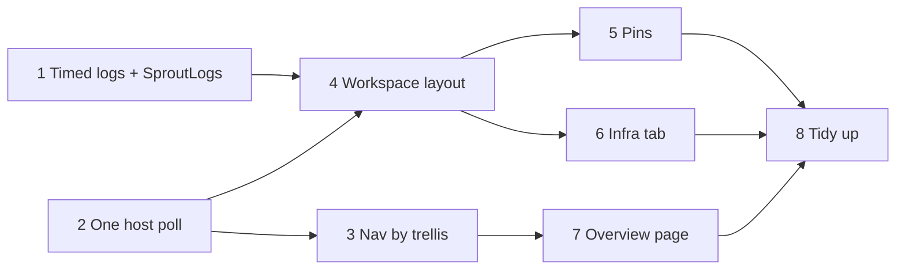

# Sprouts page redesign: plan

Branch: `experimental`. Written 2026-11-04. Status: decisions agreed (user, 2026-11-04: each recommendation below as written). Phases 1 to 8 built on 2026-11-04, not yet hand-tested. The host tests pass against the timed log format (full suite, 2026-11-06).

Where the build differs from the plan below:

- The state chips sit above the app list rather than in the header: they filter the list, and in the header they pushed the sprout's buttons off a 1024px window.
- In a window too narrow for the log and the details side by side (the log area under 760px), the details panel opens over the log's right edge, and starts closed.
- Pins (phase 5) were built with the workspace (phase 4), since the list's structure needed the Pinned group from the start.
- "Open in IDE" waits for an IDE setting. Copy env copies the values with secrets masked.
- `sprig-gui render-sprouts-sample <file.png>` draws a made-up sprout of 20 apps headlessly: every app's log at 1440×900 and 1024×700, one app's log, the Infra tab and the overview.
- 2026-11-05, after hand-testing: the sprouts no longer sit in the nav, and the nav has no "+". Sprouts in the nav is an ordinary row that always lands on the overview. The overview is where a sprout is picked: a search box (every word must match the name, trellis or branch; Esc clears it), a double-click anywhere on a row or its **Open ›** opens it, and **← All sprouts** on the sprout page goes back. The rows below about the nav's groups describe what was built first.

The target is the mock in [artefacts/sprout-layouts/](artefacts/sprout-layouts/) (published at https://claude.ai/artifact/KtgQmLR3QS6ihfa8TqYshy). It has three boards: the sprout workspace (`Main.dc.html`), the Sprouts overview (`SproutsOverview.dc.html`), and a docked-log layout kept only for comparison (`Docked.dc.html`).

## Why

The Sprouts page is one long scrolling page with a fixed-height log inside it, so the log is a scroller inside a scroller. Each app row also carries its folder and values file, so 20 apps push the log off the screen. The page has to stay usable with 20 or more apps, and the logs have to stay readable when there are that many.

## What changes, in short

| Area | Now | After |
|---|---|---|
| Page | Scrolls as a whole; the log has its own fixed 420px scroller inside it | Fills the window and never scrolls. App list, log and details are panes that each scroll on their own |
| Sprouts list | A 340px column on the Sprouts page | In the left nav under Sprouts, grouped by trellis. Groups collapse, and sprouts that are down fold into an "N down" row |
| New sprout | Modal from "+ Add" on the page | The same modal, opened from "+ Add" in the nav or on the overview page |
| Apps | A full-width row per app, with the folder and values file on a second line | A narrow list grouped by repo, with filter box, state chips, an "All apps" row and a Pinned group |
| Logs | One app at a time | "All apps" (every app's lines, interleaved, filtered by the list or by pins) or one app. Each log keeps its own search, filter, pause and scroll position |
| Following | A checkbox | Scrolling up pauses the log, and a "Jump to latest (N new)" button resumes it |
| App details | Folder and values file in the row | A Details panel beside the log: url, folder, values file, start order, readiness, restarts and env values with where each came from |
| Infra, warnings | Panels below the log | A second tab, "Infra, worktrees and files", with a warning count on the tab |
| Many sprouts | No overview | A Sprouts overview page: a table of every sprout, with bulk bring up, take down and remove, and a warning about uncommitted or unpushed work before removing |

## Decisions

Each was agreed as recommended.

1. **Timestamps in log files.** The "All apps" stream has to put lines from 20 files in order, but log lines carry no time today. A live stream can be ordered by when lines arrive, but the history already in the files can't.
   - *Recommended:* the supervisor writes a fixed-width time prefix on each line (`11:42:03.118 `, local time, with a date line when the date changes). It's the only place that knows when a line arrived, and the time also helps in the file itself and in `sprig logs`. Readers parse it into a separate field and the CLI shows it only with `--timestamps`. Older logs without the prefix are read as untimed lines, ordered by file.
   - *Alternative:* a sidecar index file per log (byte offset → time), which keeps the log file exactly as the app wrote it.
2. **Where pins are kept.** *Recommended:* per trellis, in a small UI state file in the store (`ui.json`), so pinning orders-api applies to every sprout of storefront and survives restarts. The alternatives are per sprout, or only for the session.
3. **What "Start all" starts when the list is filtered.** *Recommended:* always every app, as it does now. A separate "Start shown" can come later if it's missed.
4. **How many log lines stay in memory.** *Recommended:* 5,000 per app and 20,000 for the interleaved stream; the file on disk keeps everything, as now. The current 20,000 per pane is only fine because there's one pane: 20 apps at 20,000 lines each would be 400,000 lines in memory.

## Phases

Each phase leaves the app working and is tested on its own. Sizes are rough: S is under a day, M is one to two days, L is more.

### 1. Engine: timed log lines and a sprout's logs as one store (M)

- `Supervisor.Runner.Write` prefixes the time (decision 1). `LogTail.ReadNew` returns `LogEntry(DateTimeOffset? Time, string Text)` instead of strings. `LogFollower` and `sprig logs` print without the time unless `--timestamps` is passed.
- `LogLevel.Of(text)`: one heuristic, in the engine, for error, warning, sprig and info lines. It covers .NET (`fail:`, `crit:`, `warn:`, unhandled-exception stack lines), Node and Vite (`error`, `ERR!`, `[vite] warning`), sprig's own `sprig: exited with code N` (an error when N isn't 0), and red ANSI colour as a fallback. Tested with real samples from the testbed apps.
- `SproutLogs` (app side): one `LogTail` per app in a sprout, read every poll, off the UI thread. It keeps a bounded buffer per app and a merged buffer ordered by time (decision 4), and raises one event per poll with what was added. A runner starting again clears that app's buffer and removes its lines from the merged buffer, as `LogPaneViewModel` does today.
- Tests: ordering across files, untimed lines, trimming at the caps, restart clearing, and each `LogLevel` sample.

### 2. One host poll for the whole app (S)

- Move the one-second host poll out of `SproutsView`'s timer into a `HostStatus` service owned by `MainWindowViewModel`. It asks the host once per second for every runner, of every sprout, and publishes the result.
- `SproutsViewModel.ApplyRunners` and the nav (phase 3) both subscribe. While the window is minimised it polls every 5 seconds instead.
- Tests: subscribers get each result, and no host means "nothing running" rather than an error.

### 3. Nav: sprouts by trellis (M)

- Replace the static `Sprouts` entry in `MainWindowViewModel.NavItems` with a `SproutsNavViewModel`: groups by trellis, each holding the sprouts that are up, starting or failed, plus an "N down" row that opens to show the rest. Group headers show "2 up · 6", or "1 failed" in red. Collapsed groups are remembered in `ui.json`.
- Each sprout's second line comes from phase 2's poll: "18 of 20 running", "apps stopped", or "failed: <first line of the error>".
- Clicking a sprout opens the Sprouts page with it selected. Clicking "Sprouts" opens the overview (phase 7). "+ Add" opens the Sprouts page with the new-sprout modal open.
- The groups scroll inside the nav, with Settings and About pinned below them, as the nav's `ScrollViewer` already does.
- Remove the 340px list column from `SproutsView`. Until phase 7 exists, clicking "Sprouts" shows the existing empty-state text.
- Tests: grouping, folding, the order within a group (failed, then up, then starting), and the second line for each state.

### 4. The workspace layout (L)

The core of the redesign. `SproutsView` becomes a fixed-height `Grid` with no outer `ScrollViewer`.

- **Header:** title, state, branch, port policy and repo count; state chips ("16 ready", "2 need attention", "2 stopped or done") that filter the list; Start all, Stop apps and Take down; and a "⋯" menu for Bring up and Remove. The remove confirmation becomes a small modal, like the add modal.
- **Tabs:** "Apps and logs" and "Infra, worktrees and files", with a warning count on the second tab.
- **App list** (left, 340px, resizable with a `GridSplitter`): a filter box, the "All apps" row, then the repo groups (collapsible, each with a caption such as "2 need attention"). A row is the state dot, the name, the state or detail, and the port. Restart and Stop show on the selected row. The list is a virtualised `ListBox`, with each repo's header as an item of the same list.
- **Log pane:** a header (the app's name and state, or "All apps" with its "Apps in the list / Pinned" switch); a toolbar with search, "Warnings and errors" and Details; then the lines. In the All apps view each line starts with the app's name, in that app's colour (the same shortest-unique names as `LogFollower.Labels`), and clicking a name opens that app's log. Lines keep their ANSI colours through `AnsiLine`.
- **Per-log state:** a `LogView` per key ("all" or an app's key) holds the search, the warnings filter, whether it's following, and the line it was scrolled to. It's restored when you come back to that log. The pane binds to the current `LogView` over `SproutLogs`, replacing `LogPaneViewModel`.
- **Pause on scroll:** scrolling more than about a line from the bottom sets following off. The view keeps its place (anchored to a line number, not a pixel offset, so trimming doesn't move it) and shows "Paused · N new lines · Jump to latest". Jumping, or scrolling back to the bottom, resumes following. This replaces the Follow checkbox and the `KeepNewestInView` code in `SproutsView`.
- **Details panel** (right, 300px, toggled): for the selected app, which is the last one picked even while "All apps" is showing. It holds the url (clickable), folder, values file, what it starts after, what makes it ready, restarts, and the values with where each came from (from the plan's `PlannedValue.Via`). It has Open folder and Copy env buttons, and shows the log file path at the bottom. "Open in IDE" from the mock needs an IDE setting that doesn't exist yet, so it waits until there is one.
- Keyboard: Up and Down move through the list, Enter opens the log, Ctrl+F focuses the log search, End jumps to the latest line.
- Tests (view models): which lines a `LogView` shows for each filter, keeping and restoring per-log state, pausing and resuming, the state chips filtering the list, and repo captions.
- Check headlessly: `render-sprouts` draws the page with 20 sample apps and a failing one, at 1440×900 and at 1024×700.

### 5. Pins (S)

- A pin button on each row, shown on hover and always shown on pinned rows, and a Pinned group above the repo groups. The "All apps" view gets its "Apps in the list / Pinned" switch.
- Pins are stored per trellis in `ui.json` (decision 2). Pins whose app is no longer in the trellis's plan are dropped when shown.
- Tests: pinning, unpinning, keeping pins across view models, and dropping pins for apps that are gone.

### 6. The "Infra, worktrees and files" tab (S)

- Move today's Infra and Warnings panels here. Add Worktrees: each repo's folder and whether it's clean, has N changed files or N unpushed commits. Git runs off the UI thread when the tab opens, reusing the `GitClient` checks `Remove` uses. Add the files sprig wrote, from `SproutRecord.Files`, each with whether the repo ignores it.
- Tests: worktree status for clean, changed and unpushed repos, against a temporary git repo as the existing sprout tests do.

### 7. Sprouts overview page (M)

- Clicking "Sprouts" in the nav shows a table of every sprout: name and branch, trellis, state, apps ("18 of 20 running"), port range, worktrees, and when it was last up. It has state chips, sortable columns and "+ New sprout".
- Ticked rows get a bar with Bring up, Take down and Remove…. "Select the N down for over a week" is a shortcut for clearing out old ones.
- **Removal guard up front:** split the uncommitted and unpushed checks out of `SproutService.Remove` into `SproutService.CheckRemovable(record, deleteBranch)`, which `Remove` still calls. The overview calls it for the ticked sprouts and warns before you confirm. Remove still refuses those sprouts, so it's never only the warning that protects them.
- Several sprouts run one after another in one progress window, with a section per sprout. One failing doesn't stop the rest, and the summary lists which failed and why.
- "Last up" needs a time: add `LastUpAt` to `SproutRecord`, set by `Up`. Older records fall back to `UpdatedAt`.
- Tests: `CheckRemovable` (moving it mustn't change what `Remove` refuses), running several sprouts, and the stale-selection shortcut.

### 8. Tidy up (S)

- Delete `LogPaneViewModel` and the old row templates once nothing uses them.
- Update the hand-test checklist's Sprouts, Running the apps and Taking down sections, and add rows for pins, pause on scroll and bulk removal.
- Add changelog entries when the version is next bumped.

## Order and dependencies

Phases 1 and 2 can be done in parallel, and so can 3 and 4. Phase 4 is the one to review closely: it replaces the page's whole structure.

## Risks

- **Many tails at once.** 20 `LogTail`s read once a second is 20 small file reads, which is fine. A very chatty app (thousands of lines a second) could still make each poll slow. `SproutLogs` reads at most 2,000 lines per app per poll and catches up on the next one, so one noisy app can't stall the others.
- **Virtualised lines of different heights.** Wrapped lines differ in height, which makes holding a scroll position harder in a virtualised list. Keeping the place by line number (phase 4) avoids depending on pixel offsets. If wrapping still makes it jumpy, the fallback is no wrapping plus a horizontal scroll, the way terminals behave.
- **Guessing levels from text.** `LogLevel.Of` will mislabel some lines. It only drives colour and the "Warnings and errors" filter, never state, so a miss is cosmetic. Its samples are the place to add each one that's found.
- **Changing the log file format** (decision 1) affects anyone reading the files directly. It's experimental, so there's no compatibility to keep beyond reading old files without a prefix.

## Not in this plan

- A split view with two logs side by side.
- A quick switcher (Ctrl+K) for sprouts.
- Traces and metrics. Those stay with the Aspire dashboard idea in the roadmap.
