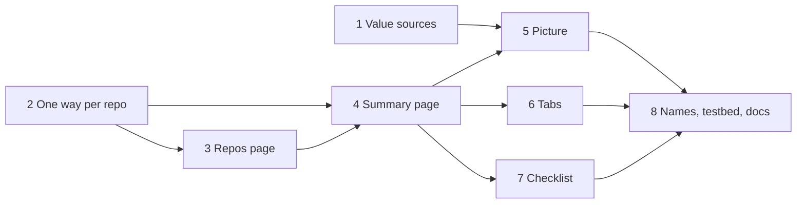

# Trellis page redesign: plan

Branch: `experimental`. Written 2026-11-05. Status: agreed direction (user, 2026-11-05: the recommended blend from the options canvas). Breaking changes allowed: no migration for old definitions or store data. Phases 1 and 2 done 2026-11-05; phases 3 to 8 done the same day (294 tests pass), checked with headless renders. Waiting on the user's hand pass (the updated hand-test checklist), and one item left open in phase 8.

The options and the reasoning are on the canvas at https://claude.ai/artifact/QqNHSoEZhiQ5B5zjwgBqhy, with a copy in [artefacts/trellis-options/](artefacts/trellis-options/). This plan builds the blend: names and badges from the Model board, a Repos page (C), a summary trellis page (A) with the picture at its centre (B), and the checklist (D) only while something blocks a first sprout.

## Why

Today's Trellises page is `sprig plan` printed in full. It answers "what will every app get?" before "what is this, can it run, how do I start one?". It also mixes two lists in one column, shows where a file is kept only as buttons (Edit, Copy into sprig, Use its own sprig.cs), and has no way to start a sprout.

## Decisions

1. **Three nouns and one badge.** Repo, Trellis and Sprout stay. "Virtual" goes from the app. Every repo and trellis shows where its file is kept: **in repo** or **in sprig**. The app says **needs** and **offers**; the SDK keeps `Import`, `Export` and `Bind`.
2. **Two ways to put a repo in a trellis, not three.** `trellis.Repo("path")` uses the folder's own `sprig.cs`. `trellis.UseRepo("id")` uses an entry from the Repos list, whose file is in the repo or in sprig. `Repo(path, definition: "id")` is removed: a definition in sprig always belongs to a Repos entry.
3. **Where a repo's file is kept is fixed for its ID** (revised by the user after phase 8; it was first a switch on the repo). A switch meant what a trellis using the ID ran could change under it. Instead, the other kind is always a new entry:
   - *Copy into sprig* (on an in-repo entry) makes a new in-sprig ID starting from the folder's `sprig.cs`, with the approval it had.
   - *Write to the repo* (on an in-sprig entry) writes the definition into the folder as `sprig.cs`, left uncommitted, and uses it from a new in-repo ID. It's refused if the folder already has a `sprig.cs`.
   - The entry it started from, and every trellis using it, is left as it is; pointing a trellis at the new ID is done by hand. A folder's own `sprig.cs` is listed under at most one ID.
4. **A trellis's file location is shown, not switched.** Moving a trellis between a folder and sprig needs a destination folder; that waits until it's asked for.
5. **The plan says where values come from as data.** `PlannedValue` gains `Sources` beside the `Via` text, so the picture never parses display strings.
6. **No migration.** Model schema goes up, so definitions cached under the old schema are re-run. Repos entries and trellises in the dev store that use `definition:` are deleted rather than converted; the testbed is updated to match.

## Phases

Each phase leaves the app building and the tests passing. Sizes: S is under a day, M is one to two days, L is more.

### 1. Engine: where each value comes from, as data (S) ✅ done 2026-11-05

- [x] `ValueSource(Owner, Resource, Endpoint, Import)` on `PlannedValue.Sources`: each endpoint a value reaches, with the import it crossed through. A trellis binding to a literal has the trellis as owner and no resource. An import nothing fills has no owner.
- [x] Thread sources through `Resolve`, `ResolveRef`, `ResolveImport`, `ResolveNamedExport` and `ResolveTemplate` alongside `via`.
- [x] `Plan.Wires()`: one `PlannedWire` per app value that crosses from another owner or through an import (consumer app and key, import, provider owner, resource and endpoint; no provider when unfilled).
- [x] `PlanView.Wiring` reads wires instead of parsing `Via[0]`, and now names the app a value comes from ("shop-services / catalog-api (catalog-url)").
- [x] Tests: automatic import with a same-repo reference beside it (no wire), trellis bindings to infra, to a literal and to a named export, and an unfilled import.

### 2. Model: one way per repo, and the storage switch (M) ✅ done 2026-11-05

- [x] SDK: `definition:` dropped from `Trellis.Repo` and `RepoRefModel.Definition`; model schema 7, so older cached models re-run.
- [x] Loader: the `definition:` branch is gone. A `Repo(path)` folder without a `sprig.cs` says to commit one or add the folder on the Repos page and use `trellis.UseRepo("id")`.
- [x] `VirtualDefinitions` became `StoredDefinitions` (the Repos list and trellises kept by sprig). `RepoEntry` is `Id`, `Folder` (now required), `InRepo`, `DefinitionFile` and `HasCopy`; sprig's copy lives at `<store>/repos/<id>/sprig.cs` and stays when a repo switches back to the repo. Entries without a folder are ignored.
- [x] `TrellisAuthoring`: `AddRepo`, `KeepInSprig`, `PutInRepo` (decision 3) and `UseFromRepos` (rewrites `Repo("path")` as `UseRepo("id")` through `DefinitionEditor.RepoToUseRepo`). A copy keeps the approval of what it was copied from. `DescribeInSprig`, `UseOwnDefinition`, `WriteRepo`, `ReferenceRepo`, `SetRepoDefinition` and `Scaffold`'s `definition:` output are gone.
- [x] `UsedBy(id)` stays a text search of registered trellises for `UseRepo("id")`; reading models instead waits until the Repos page needs it.
- [x] Tests: each switch direction (with and without the folder's own file, and restoring an earlier copy), `AddRepo` both ways through `CreateTrellis`, `UseFromRepos`, and the Repos-list sprout tests moved to `UseRepo`.
- [x] Interim UI so the app keeps working until phases 3 and 4: the Repos column has one "+ Add"; a trellis's repo rows offer "Keep in sprig" / "Put in the repo" (Repos entries) or "Add to Repos" (repos named by folder); the selected repo has the same switch.
- [x] Data: the dev store had no `repos/` or `trellises/` folders and both registered testbed trellises use `Repo(path)`, so there was nothing to purge.

### 3. Nav and the Repos page (M) ✅ done 2026-11-05

- [x] Nav: DEFINE holds **Repos** then **Trellises**, each with a one-line subtitle ("what each repo runs", "repos run together"); RUN's Sprouts gets "running copies". Pages give theirs through `PageViewModel.NavSubtitle`.
- [x] The editor pane is `DefinitionEditorViewModel` and `DefinitionEditorView` (open, save-approves, discard guard, status line); the page that opens it says what a save means through `AfterSave`.
- [x] `ReposViewModel` and `ReposView`: the list (ID, badge, "3 apps · 3 infra" once its definition has run), "+ Add" (folder and ID), and the selected repo: its folder (the only place a path shows), "Used by" links to each trellis, the In the repo / In sprig switch with what each means, then Runs, Infra, Offers and Needs from its model. Open definition, Remove (asks first).
- [x] A repo that isn't approved says so with Read it and Approve; one that fails or describes a trellis says why where the sections would be.
- [x] Tests: a repo not yet approved, switching it into sprig (the copy stays unapproved), and describing offers in words. Used by is covered by the authoring tests.

### 4. The trellis page: summary first (M) ✅ done 2026-11-05

- [x] The Trellises column is one list: name, badge (in sprig / in a folder) and its sprouts ("1 sprout up", "no sprouts", "not approved yet"). "+ Add" first asks which kind, with two cards: **I have a .trellis.cs** opens the file modal, and **Build one from repos** opens the new-trellis modal. Each has **← Back** to the cards. The repo count is in the description instead, since it's only known once the trellis has run.
- [x] Header: name, badge, a one-line description ("Runs shop-services, shop-web and shop-mobile together."), **Start a sprout** (opens the Sprouts page's new-sprout modal with this trellis chosen; disabled unless it's ready), Edit code, and a "⋯" menu for Check again and Remove, always the rightmost button.
- [x] Status line: checking, ready (with any warnings), needs approval, can't plan, or N problems, with the time it was checked.
- [x] Tabs: **Overview**, **Values** (with its count of values), **Ports** (with its count) and **Code**.
- [x] Overview: approval and problem panels when they apply, then repo cards (badge, runs, infra, offers, and each need with what fills it, amber when nothing does), How sprouts run (worktrees, ports, groups naming a whole repo once), Added by the trellis, and Sprouts of it (from the sprout store).
- [x] A `Repo(path)` card offers "Open its definition" (in the Code tab) and "Add to Repos"; a `UseRepo` card offers "Open on Repos".
- [x] Tests: the description, card contents and needs from a plan (filled by a repo, by the trellis, and unfilled), what the trellis adds, its policies, and a card for a repo that hasn't run. The status line and Start a sprout are checked in renders only so far.

### 5. The picture (L) ✅ done 2026-11-05

- [x] `TrellisGraph`: a box per repo holding its apps and jobs (each a line wires attach to) with its infra on one line; a box for what the trellis adds; a wire per `PlannedWire`, labelled with its import; a stub labelled "nothing fills …" for an unfilled need.
- [x] Layout: what the trellis adds takes the first column (it only ever offers); each repo sits one column right of the furthest-right repo it takes from; within a column a repo sits near the ones it takes from. Folding repos with many apps waits until a trellis needs it.
- [x] Drawing: boxes are ordinary controls on a canvas; `WireLayer` draws the curves, arrowheads and labels behind them, moving a label down when it would cover another. The picture scales down to fit, never up.
- [x] Clicking an app lights its wires and shows its values (with where each came from) below the picture; clicking a repo's title shows its card there (runs, infra, offers, needs, and Open on Repos, Open its definition or Add to Repos). The picture replaces the repo cards once the trellis plans; the cards stay while it can't.
- [x] Group chips (Everything, then each group) dim what a group doesn't start; what the trellis adds never dims.
- [x] Tests: columns and box contents, wires and the unfilled stub, highlighting a picked app, and group dimming. `render-trellises` also renders a picked app with a group shown.

### 6. Values, Ports and Code tabs (S) ✅ done 2026-11-05, with phase 4

- [x] Values: the per-app panels, what the repos need and what fills it (formerly Wiring), containers and compose changes. A filter by repo or app waits until it's missed.
- [x] Ports: the ports table, with a line saying it's a preview.
- [x] Code: the trellis's file (or a repo's, opened from its card) in the shared editor; a save plans again and says whether it plans, and the other tabs show the result. Closing the editor goes back to Overview.

### 7. The checklist, only while something blocks (S) ✅ done 2026-11-05

- [x] While a trellis can't make a sprout, the Overview opens on "Before its first sprout": Review the code, Its definitions run, What the repos need, The plan checks out, Start a sprout. Approval comes first, since nothing runs until then; "How sprouts run" isn't a step, since it never blocks a sprout (the summary shows it). Each step shows done, open (with the one action that clears it: Review N files, Open the code, Fill it in code, See them on Values) or waiting on the one above. **Review N files** opens the review dialog: each file waiting for approval on the left, the picked one read-only on the right, approved one at a time (or **Approve all** while more than one is left). It stays open when approving the trellis file turns up its repos' files. The Sprouts page uses the same dialog, opening it by itself when an action it started needs approval, with a notice and button to reopen it.
- [x] Start a sprout is disabled in the header while any step is open, and the status line says why. Once all are done the checklist goes and the summary shows. The approval panel stays below it as the list of files to read.
- [x] Tests: each step's state for unapproved code, a repo that didn't run, an unfilled need, other plan errors, and nothing in the way.
- [x] Found on the way: the page planned once when built and again when shown, running the same trellis twice at once, and two `dotnet run`s of one file clash in dotnet's build output (seen only when the SDK had just been rebuilt). Pages now run definitions only when shown, and `DefinitionRunner` runs one file at a time; a second caller waits and reads the cache.

### 8. Names, testbed, data and docs (S) ✅ done 2026-11-05, one item open

- [x] Swept the app's text: "virtual", "written in sprig", "referenced" and "wiring" are gone; the Values tab's "trellis binding" now reads "the trellis". "Kept in sprig" stays where it explains the "in sprig" badge.
- [ ] Testbed: a trellis that uses `UseRepo`. Left open: it can't plan without Repos entries in the user's store, and nothing can make those from a script yet. A `sprig repo add|ls` CLI command would let `testbed.ps1` set them up. Until then, `UseRepo` is covered by the authoring and sprout tests and by the hand-test steps that add repos in the app. `render-trellises` renders the Overview, a picked app with a group shown, Values, Ports, the Repos page, the add modal and an unapproved trellis.
- [x] Data: nothing to delete (checked in phase 2).
- [x] The hand-test checklist's Trellises section is rewritten for the new pages (new item IDs TP1 to TP8), with a new Repos section (RP1 to RP5). The roadmap's M7 section and the changelog's Unreleased notes describe the redesign.

## Order

Phases 1 and 2 are independent. Phase 5 is the one to review closely: it's the only new kind of control.

## Risks

- **Layout of the picture.** Twenty apps across four repos is a lot of boxes. Folding apps inside their repo box and drawing wires between repos (expanded on click) is the fallback if it gets busy.
- **Dropping `definition:`** breaks any trellis file that uses it, including ones in the dev store. Decision 6 accepts that; the loader's message says what to use instead.
- **Two pages for authoring.** Moving between Repos and Trellises while editing could feel slower. The trellis cards link straight to their repo, and the repo's Used by links back.

## Not in this plan

- Moving a trellis between a folder and sprig (decision 4).
- Live state on the picture (running, failed) and opening a log from it. That's the roadmap's Live graph item, and it builds on phase 5.
